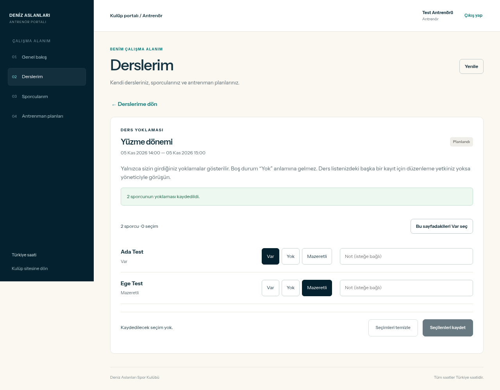
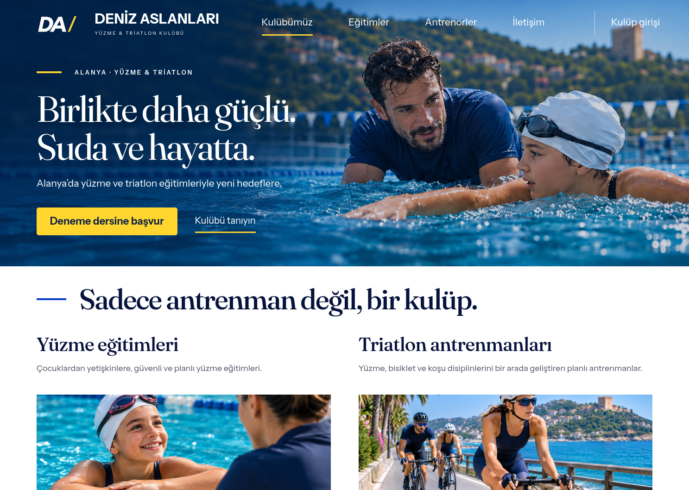
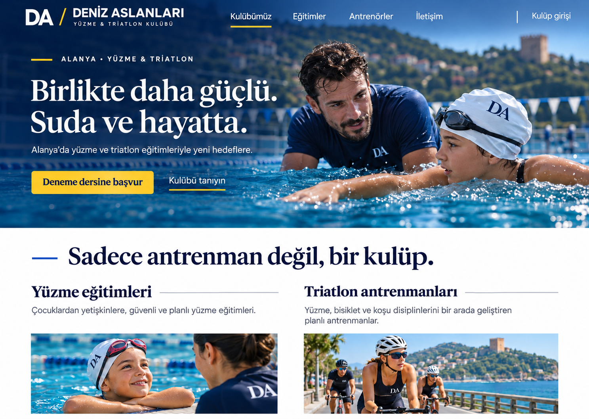
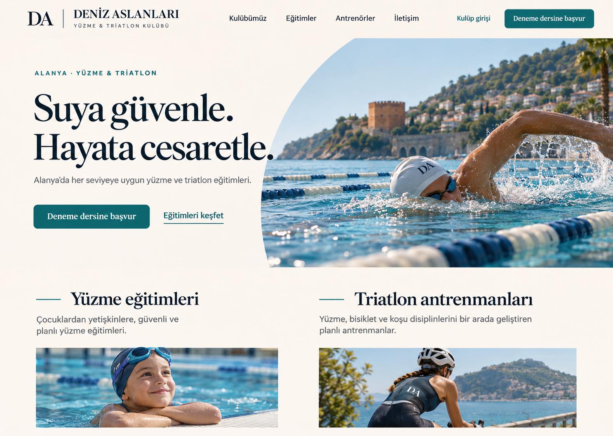
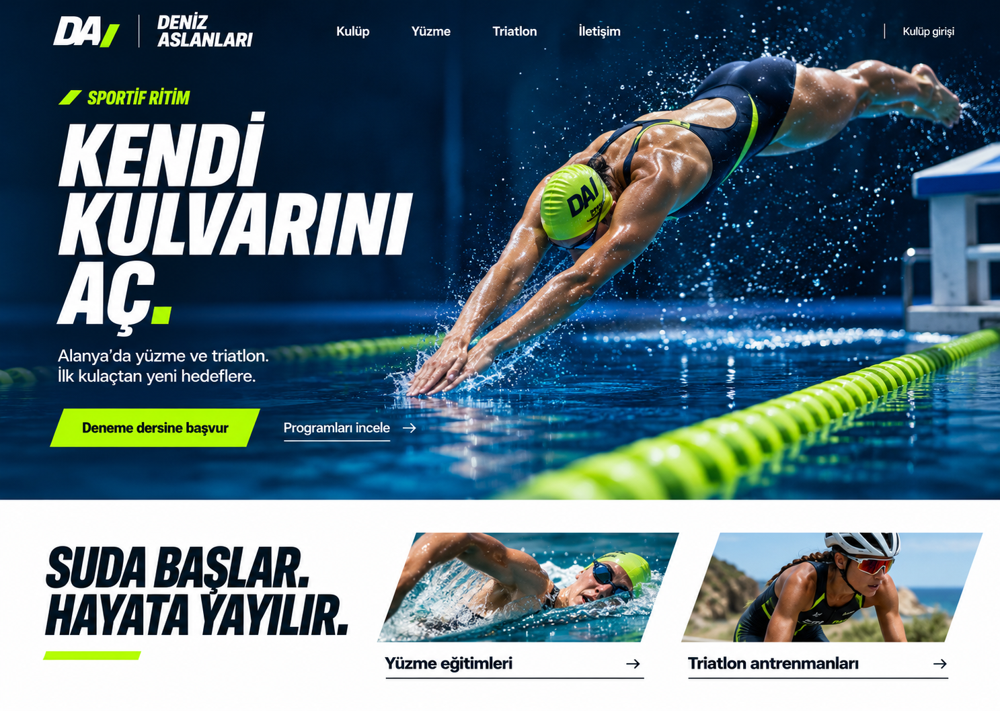
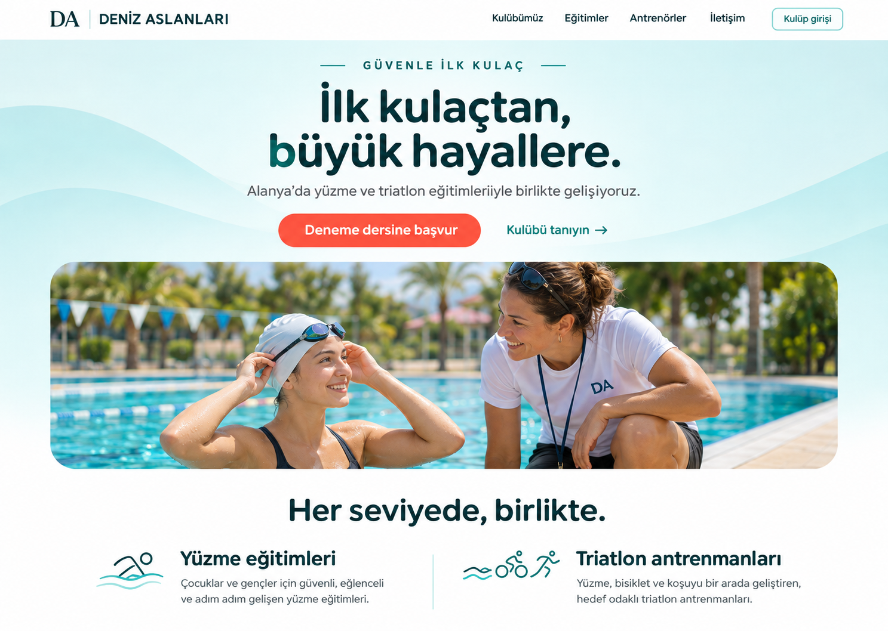
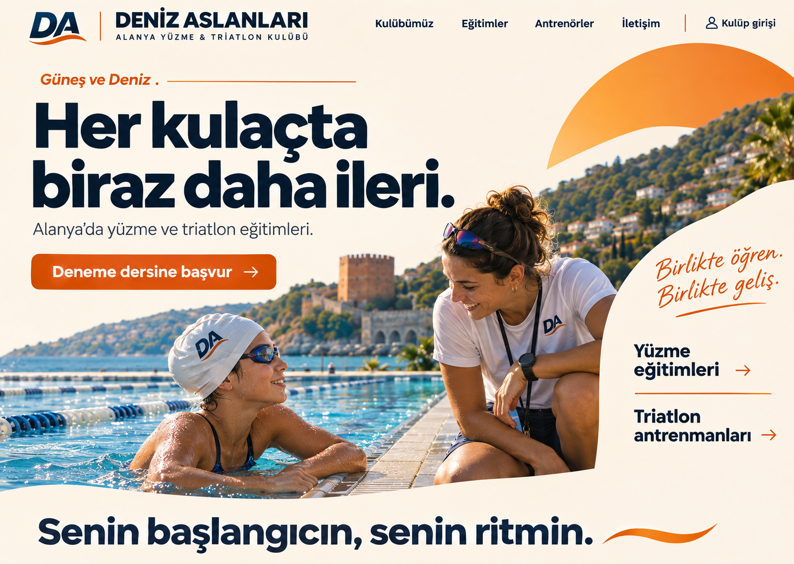
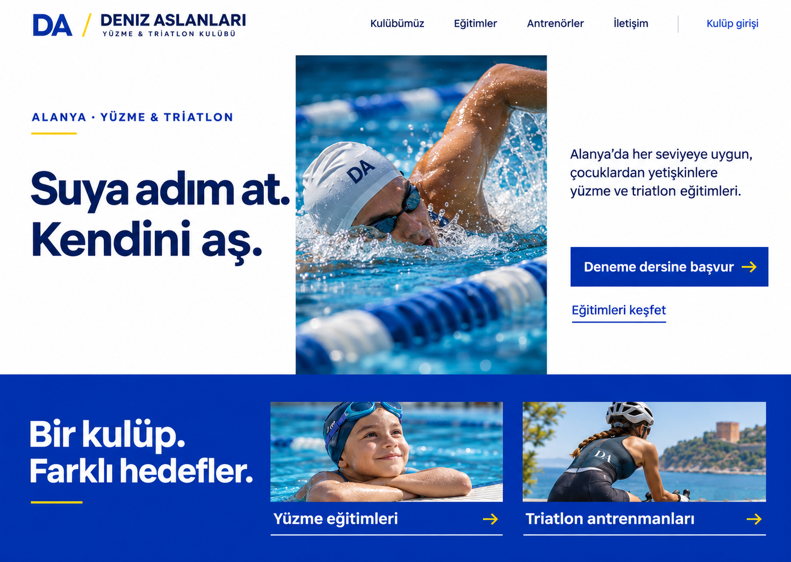
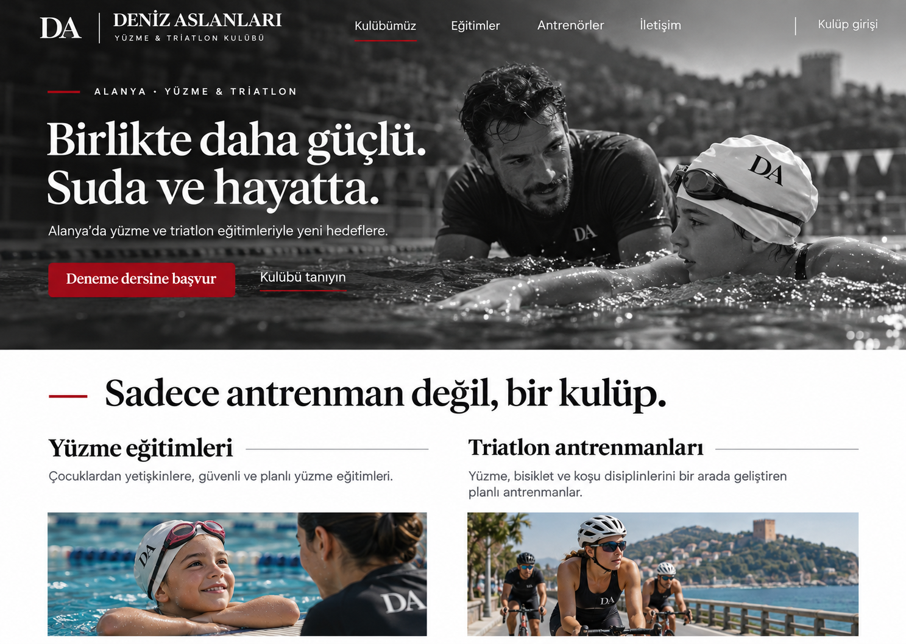

# Ana site ve paneli tek hesapta toplama

[Ana site taşıma paketi](ana-site-tasima.zip) · [Orijinal yayın yedeği](ana-site-orijinal-yedek.zip) · [Taşıma notları](ANA-SITE-TASIMA.md)

[Masaüstü görünüm](assets/ana-site-panel-baglantisi.png) · [Mobil menü](assets/ana-site-panel-mobil.png)

# Panelden antrenör daveti

[006 bir defalık SQL kurulumu](antrenor-davet-kurulum.sql)

[Antrenör davet paneli](assets/antrenor-davet-paneli.png) · [Hesap yönetimi / mobil](assets/antrenor-hesap-yonetimi-mobil.png) · [Antrenör kayıt ekranı / mobil](assets/antrenor-davet-kayit-mobil.png)

İlk kurulumda Supabase Authentication → URL Configuration:
- Site URL: `https://alanyadenizaslanlari.netlify.app`
- Redirect URLs: `https://alanyadenizaslanlari.netlify.app/**`
- Email sağlayıcısında yeni kullanıcı kaydı ve Confirm email açık olmalı.

Sonrasında yönetici Antrenörler → Antrenör davet et ile bağlantı oluşturup paylaşır. Antrenör kendi parolasını belirler; doğrulama e-postasını Supabase Auth gönderir. Yeni antrenörler için SQL gerekmez. Görseller test verileriyle alınmıştır.

# Sade paneller ve yeni özellikler

[005 ek SQL kurulumu](profil-sporcu-kurulum.sql) — 001–004 tekrar çalıştırılmaz.

[Yönetici ana ekranı](assets/sade-yonetici.png) · [Tek formda ders oluşturma](assets/tek-form-ders.png) · [Antrenör profili / mobil](assets/antrenor-profil-mobil.png) · [Sporcu talepleri](assets/sporcu-talepleri.png)

Ekran görüntüleri test verileriyle alınmıştır.

# Antrenör paneli

[Yeni antrenör SQL kurulumu](antrenor-kurulum.sql)

[Mobil görünüm — test verileri](assets/antrenor-mobil.png)

# Uygulama ekranları

[Site içeriği paneli (test verileri)](assets/site-icerigi-paneli.png)

[Ek SQL kurulumu](site-content-kurulum.sql)

# Seçilen birleşim: 6 yerleşim + 5 renkler

# Deniz Aslanları — Tasarım önerileri

Bu dal yalnızca altı tasarım önerisini içerir. Canlı kulüp uygulaması değildir.

## Tasarım 1

[Tam boy aç](assets/tasarim-1.png)

## Tasarım 2

[Tam boy aç](assets/tasarim-2.png)

## Tasarım 3

[Tam boy aç](assets/tasarim-3.png)

## Tasarım 4

[Tam boy aç](assets/tasarim-4.png)

## Tasarım 5

[Tam boy aç](assets/tasarim-5.png)

## Tasarım 6

[Tam boy aç](assets/tasarim-6.png)
